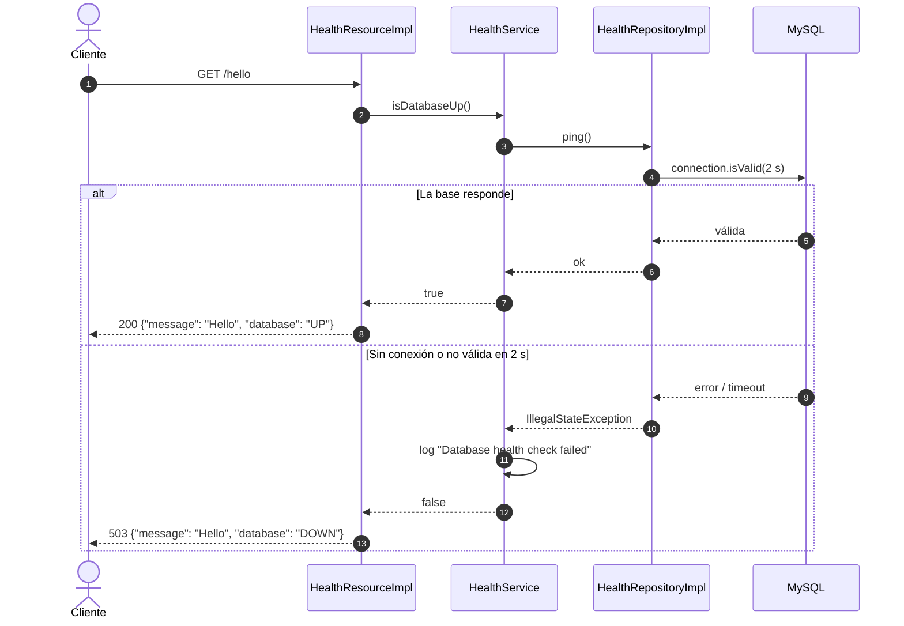

# GET /hello

[← Documentación](../README.md)

Health check: confirma que la lambda está arriba y que llega a la base de datos, sin tocar datos. Úsalo después de
cada deploy o para monitoreo.

## Request

Sin parámetros ni body.

```http
GET /api/v1/hello
```

## Respuestas

### 200

La lambda y la base de datos responden.

```json
{
  "message": "Hello",
  "database": "UP"
}
```

### 503

La lambda responde pero la base no: sin conexión o la conexión no es válida en 2 segundos.

```json
{
  "message": "Hello",
  "database": "DOWN"
}
```

## Diagrama de secuencia


