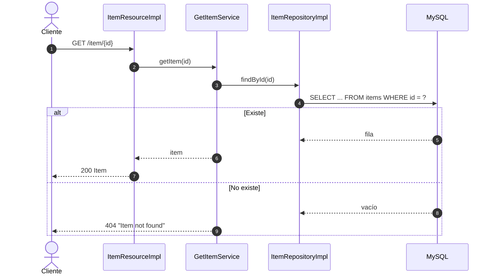

# GET /item/{id}

[← Item](README.md)

Obtiene un item por su ID.

## Request

| Parámetro | En | Tipo |
|---|---|---|
| `id` \* | path | integer |

\* Obligatorio.

```http
GET /api/v1/item/2
```

## Respuestas

### 200

El item existe.

```json
{
  "id": 2,
  "name": "Mouse",
  "unit_price": 59.90,
  "created_at": "15/12/2025 12:00"
}
```

### 404

No existe un item con ese ID.

```json
{
  "name": "quarkus-lambda-http-template",
  "message": "Resource not found",
  "code": 404,
  "errors": [
    {
      "message": "Item not found",
      "component": "quarkus-lambda-http-template"
    }
  ]
}
```

## Diagrama de secuencia


