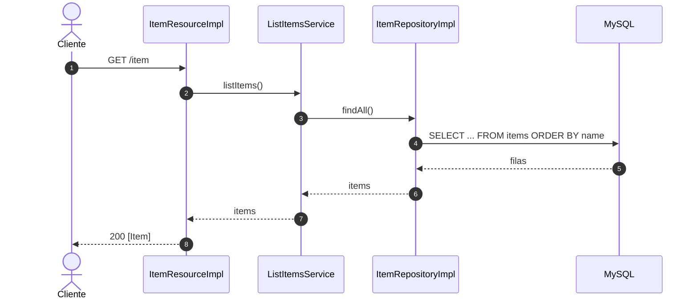

# GET /item

[← Item](README.md)

Lista todos los items, ordenados por nombre.

## Request

Sin parámetros ni body.

```http
GET /api/v1/item
```

## Respuestas

### 200

Los items ordenados por nombre. Sin items, `[]`.

```json
[
  {
    "id": 2,
    "name": "Mouse",
    "unit_price": 59.90,
    "created_at": "15/12/2025 12:00"
  },
  {
    "id": 1,
    "name": "Teclado mecánico",
    "unit_price": 149.90,
    "created_at": "15/12/2025 12:00",
    "description": "Switches marrones"
  }
]
```

## Diagrama de secuencia


