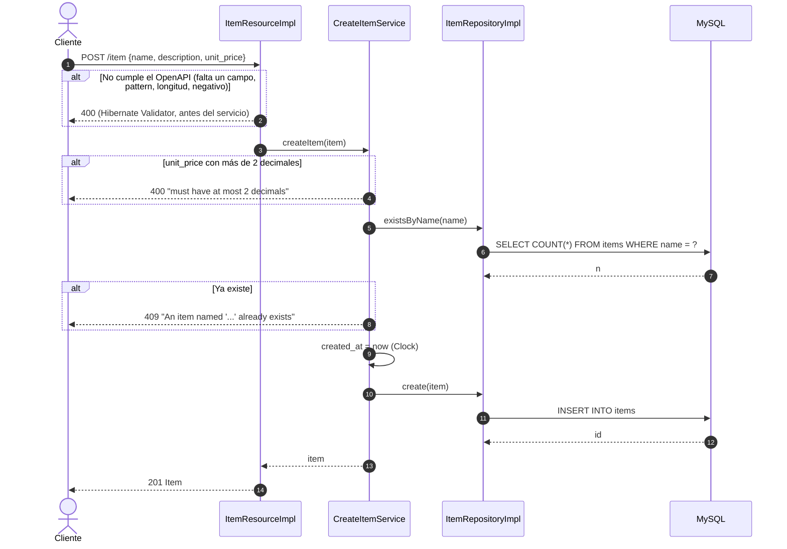

# POST /item

[← Item](README.md)

Crea un item. `created_at` es la fecha y hora del momento de la creación.

## Request

| Campo | Tipo | Pattern | Reglas |
|---|---|---|---|
| `name` \* | string | `^[\p{L}0-9 '().-]+$` | 1–100 caracteres: letras, números, espacios y `' ( ) . -`. Único |
| `description` | string | `^[^<>]*$` | 1–500 caracteres, sin `<` ni `>` |
| `unit_price` \* | number | — | 0 o más, máximo 2 decimales |

\* Obligatorio.

```http
POST /api/v1/item
Content-Type: application/json

{"name": "Teclado mecánico", "description": "Switches marrones", "unit_price": 149.90}
```

## Respuestas

### 201

Se creó el item. `created_at` es el momento de la creación y `unit_price` siempre tiene 2 decimales.

```json
{
  "id": 1,
  "name": "Teclado mecánico",
  "unit_price": 149.90,
  "created_at": "15/12/2025 12:00",
  "description": "Switches marrones"
}
```

### 400

El precio tiene más de 2 decimales, por ejemplo `{"name": "Cable", "unit_price": 10.123}`.

```json
{
  "name": "quarkus-lambda-http-template",
  "message": "Validation error occurred",
  "code": 400,
  "errors": [
    {
      "message": "The field 'unit_price' must have at most 2 decimals",
      "component": "quarkus-lambda-http-template"
    }
  ]
}
```

### 409

Ya existe un item con ese nombre.

```json
{
  "name": "quarkus-lambda-http-template",
  "message": "Conflict with the current state",
  "code": 409,
  "errors": [
    {
      "message": "An item named 'Teclado mecánico' already exists",
      "component": "quarkus-lambda-http-template"
    }
  ]
}
```

## Diagrama de secuencia


